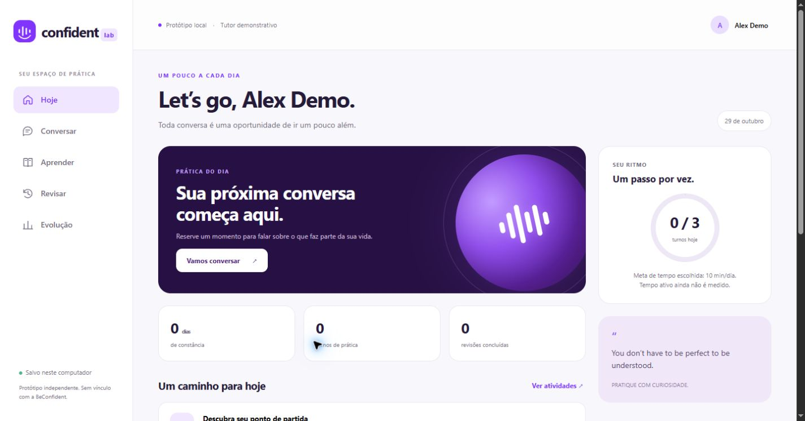

# Investigação BeConfident e reconstrução independente

Investigação em **29/10/2026**, com MCP REA, fontes oficiais e testes autorizados no WhatsApp Web do usuário. Há também um protótipo funcional local e publicado na Vercel. **A plataforma completa ainda não foi recriada.**

## O que foi comprovado

- **Aquisição:** landing Framer → atribuição de lead → redirecionamento de API → convite no WhatsApp.
- **Teste real:** nome → nível autodeclarado → três questões → descrição de foto por áudio → feedback textual/visual e áudios → resultado → plano de 30 dias → oferta → checkout.
- **Diagnóstico:** o frontend recebeu nível e cinco scores da API `lead-diagnosis`. A fórmula e o processamento do servidor não foram recuperados. Não se compararam contas ou identificadores de outros usuários.
- **Superfícies diferentes:** home Framer, plano com artefatos Astro e checkout Nuxt. Bibliotecas/pixels do site não estabelecem quais modelos o tutor utiliza.
- **Oferta:** preço, duração e garantia variam entre home, campanha pós-teste e checkout; as variantes estão registradas separadamente.

O teste utilizou nome fictício Alex e combinou respostas do agente com áudios enviados pelo próprio usuário. O resultado exibido não é uma avaliação controlada da proficiência do titular da conta. Não houve compra ou preenchimento adicional de dados financeiros.

## Leia nesta ordem

| Documento | Conteúdo |
|---|---|
| [WhatsApp observado](research/whatsapp-observation.md) | Estados realmente percorridos, correções e limites do teste |
| [Site e funil técnico](research/technical-analysis.md) | Bundles, scripts, atribuição, redirecionamentos e IDs REA |
| [Origem do diagnóstico](research/plan-technical-analysis.md) | Encadeamento API → validação → gráfico; separa origem dos números de fórmula privada |
| [Resultado, plano e oferta](research/post-assessment-flow.md) | Navegação real após o teste e diferenças comerciais |
| [Checkout](research/checkout-observation.md) | Primeira etapa, tecnologias e campos, sem pagamento |
| [Pesquisa pública](research/public-research.md) | Funcionalidades publicadas do app, trilhas, voz, social, termos e fontes oficiais |
| [Blueprint da reconstrução](research/reconstruction-blueprint.md) | Arquitetura proposta, estados, entidades, fases e 22 cenários de aceitação |
| [Contrato proposto](api/openapi.yaml) | 41 operações e 51 schemas; não são as APIs originais nem as rotas do protótipo |
| [Esquema proposto](database/schema.sql) | 35 tabelas PostgreSQL; revisão estática, ainda não aplicado a um banco |
| [Protótipo executável](prototype/README.md) | Instalação, funcionamento, testes e limitações concretas |
| [Conector Uazapi](prototype/integrations/README.md) | Cliente, receptor, fila, configuração privada e operação do piloto |
| [Conexão Uazapi histórica](research/uazapi-connection-status.md) | Histórico de conexão; veja a validação atual |
| [Publicação e situação atual](research/deployment-status.md) | Vercel, persistência, fila, DNS e integração Uazapi validada |

## Protótipo local

```powershell
cd 'D:\meus documentos\beconfident\prototype'
node server.mjs
```

Abra `http://127.0.0.1:4173`. Não é necessário instalar dependências. Para testar: `npm test` na pasta `prototype`.

Funciona: perfil, três questões próprias, conversa demonstrativa, correções limitadas, fila de revisão, atividades e progresso persistido. O aplicativo mostra explicitamente seu modo demonstrativo. Não há IA generativa, ASR, avaliação acústica, chamadas, pagamentos, login de produção ou app nativo conectados. A leitura por voz usa o navegador e não é o motor de voz do BeConfident.

O protótipo usa HTML/CSS/JS e Node, com arquivos JSON locais. O SQL/OpenAPI descreve a fundação futura, mais ampla. Nenhum asset ou bundle recuperado do produto foi importado para o protótipo.



## Fronteira da investigação

Foram preservados bundles, hashes, respostas selecionadas, acessibilidade e capturas em `research/evidence/`. Esses arquivos ficam fora do versionamento por conterem identificadores de aquisição, dados da sessão e tokens temporários. Os relatórios usam referências e valores necessários, sem publicar os tokens. Não foi baixado/retransmitido o áudio do usuário para transcrição externa.

Ainda não estão comprovados: código do servidor, prompts, modelos/fornecedores do tutor, algoritmo de proficiência, currículo integral, regras da conta paga, todas as telas autenticadas, protocolo das chamadas e implementação nativa Android/iOS. Fontes públicas e um teste gratuito não dão visibilidade completa a essas partes. A matriz de paridade no blueprint mantém essas lacunas abertas.

O conector Uazapi possui entrada/saída, filtros, estados e inbox/outbox. O projeto Vercel dedicado usa Blob privado com CAS e fila durável. Os **49 testes** passaram. A instância atual em umcaracaramelo.uazapi.com está conectada; o webhook dedicado foi registrado e a mensagem de teste foi enviada uma vez ao destinatário autorizado, com recibo Read no provedor. A entrada real e o retorno automático demonstrativo foram verificados, com recibo Delivered no provedor. As sessões web e WhatsApp ficam separadas.

Os próximos blocos são um tutor/avaliador real com rubrica própria, pipeline de áudio, persistência relacional e autenticação; depois currículo, chamadas, compras e recursos sociais. O contrato e os testes de aceitação descrevem as fronteiras que precisam ser verificadas.
