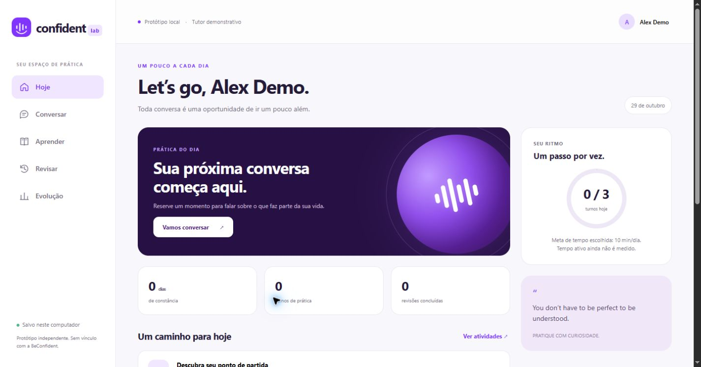
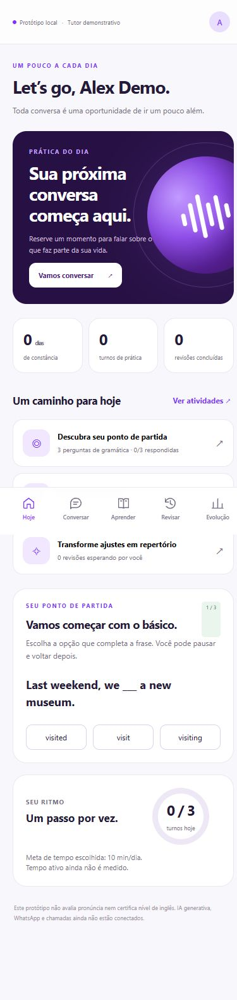

# Confident Lab

Corte vertical independente criado após investigar o BeConfident, disponível localmente e na Vercel. Veja a [validação da publicação](../research/deployment-status.md) e o [backend na nuvem](cloud/README.md). Interface própria; não é uma cópia do código original nem uma plataforma pronta para produção.

## Executar

Requisito: Node.js 24. O servidor local usa módulos nativos; o backend da Vercel utiliza os SDKs fixados no lockfile (`npm ci`).

```powershell
cd 'D:\meus documentos\beconfident\prototype'
node server.mjs
```

Abra `http://127.0.0.1:4173`. `Ctrl+C` encerra o processo. `PORT` pode selecionar outra porta antes da execução. O servidor escuta somente em loopback.

```powershell
npm test
```

O script de testes desativa isolamento por subprocesso porque o sandbox do ambiente retornou `spawn EPERM` no modo padrão. Os testes continuam usando o runner oficial `node:test`.

## Percurso disponível

1. Salve nome, nível autodeclarado e meta diária.
2. Responda três questões próprias de gramática. O resultado conta acertos, sem inventar equivalência CEFR ou percentuais de pronúncia.
3. Converse com o tutor demonstrativo. Para explorar uma correção coberta: `Yesterday I go to the park.` ou `I has a dog.`.
4. Abra Revisar, reescreva a frase e confira com a referência.
5. Faça uma das três atividades e acompanhe Evolução. Recarregar preserva o estado.

Comandos de texto: `#menu`, `Traduz`, `Corrige` e `Minha evolução`. São roteados antes da prática e não contam como turnos. Menu preserva o estado das questões.

## Implementação real deste protótipo

- `engine.mjs`: estado, perguntas/atividades próprias, regras demonstrativas e eventos de progresso.
- `server.mjs`: HTTP, sessão por cookie HttpOnly, validação, fila por sessão e persistência por gravação temporária + rename.
- `public/`: interface responsiva sem bibliotecas, textos escapados e navegação acessível.
- `.data/`: arquivos por sessão, ignorados no versionamento. Um cookie diferente cria outro perfil; não há sincronização de contas entre navegadores.
- `engine.test.mjs`: invariantes de avaliação, idempotência, comandos e revisão.

Rotas do aplicativo: `GET /api/health`, `GET /api/state`, `POST /api/action`. As ações são `profile`, `answer`, `message`, `review`, `lesson` e `reset`. Toda mutação de sessão exige `Idempotency-Key`. O OpenAPI da raiz é uma **proposta futura** mais ampla; não representa a implementação dessas rotas.

O [conector Uazapi](integrations/README.md) possui HTTP e inbox/outbox locais. A versão Vercel usa funções em api/, Blob privado, CAS, fila e administrador autenticado. A instância atual está conectada; webhook registrado e teste de saída enviado uma vez, com recibo Read no provedor. A produção permite somente o contato de teste; o arquivo local mantém dry-run. A entrada real e o retorno demonstrativo foram verificados, com recibo Delivered. npm start carrega .env.local.

## Limites visíveis

O tutor não gera respostas abertas: usa perguntas e quatro padrões de correção pré-definidos. A revisão compara com uma referência e pode não reconhecer alternativas corretas. A conclusão de atividade registra participação, sem certificar domínio. A meta de tempo fica no perfil, mas tempo ativo não é contado. O streak usa America/Sao_Paulo; não há troca de fuso no protótipo.

Voz disponível somente como leitura do texto pelo navegador. A disponibilidade depende do navegador/sistema e o recurso pode consultar o serviço de voz configurado por ele. Não há gravação, upload, ASR ou diagnóstico de pronúncia. O conector WhatsApp está ativado para o contato de teste; chamadas em tempo real, assinatura, app nativo e recursos sociais ainda não estão implementados.

Não há login/multiusuário de produção, recuperação de conta, persistência relacional nem migração automática do JSON para o esquema SQL. O backend WhatsApp tem integração opcional com GPT-4o direto na OpenAI, protegida por chave privada e flag de ativação. A chave ainda precisa ser preenchida e validada para habilitar a IA; a interface web e o servidor local continuam demonstrativos. Veja a [configuração de IA textual](cloud/README.md#ia-textual-no-whatsapp).

## Verificação

Os 49 testes atuais passaram (núcleo, fluxo WhatsApp, conector, armazenamento concorrente, bridge na nuvem e sessão web). O percurso real da interface web foi testado via CUA: perfil → avaliação 2/3 → mensagem com erro → correção e revisão → atividade → recarga → progresso persistido (2 turnos, 1 atividade, 1 revisão). O menu não contou como turno. Console sem erros no recorte inspecionado. Desktop e mobile 390×844 foram verificados; não houve overflow horizontal na medição do mobile. A mensagem real de teste Uazapi foi aceita e seu recibo Read foi consultado por tracking; a entrada real e o retorno demonstrativo também foram confirmados, com recibo Delivered.

O IAB permitiu testar o fluxo, mas a API de screenshot excedeu o tempo limite. As capturas visuais foram feitas pelo Chrome via CUA. O PostgreSQL proposto na raiz não foi executado.




