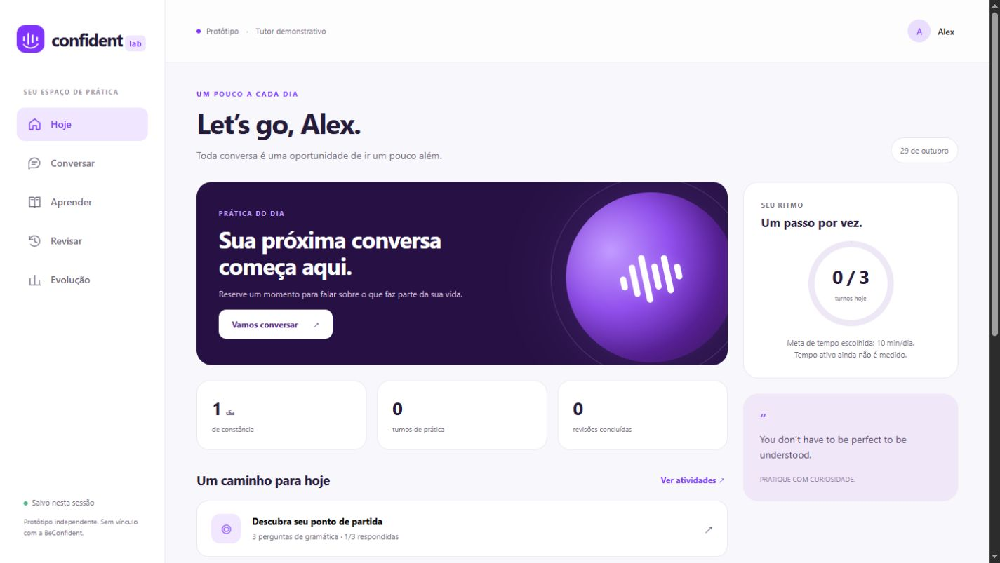

# Publicação e validação do piloto

Rodada de 29/10/2026 (America/Sao_Paulo; consultas finais após 00h UTC de 30/10).

## Resultado real

- Projeto Vercel dedicado: **confident-lab**, separado de lab-caramelo.
- Endereço estável: https://confident-lab-holaluiz.vercel.app/ . A proteção Vercel permanece ativa; o titular pode acessar com sua sessão.
- Último deployment: `dpl_FjYsMnntwTQ3xcSHPR5PjdqE6CpJ`, estado **READY**.
- Node 24, funções e fila em `gru1`, Blob privado. Pacote por lista explícita de 21 arquivos, sem `.env`, conversas ou evidências brutas.
- SHA-256 do pacote local: `33268107820fa15b2e747962153f96a6018cfa93f8cd6b70797b0933be4f7037`.
- O usuário autorizou a credencial de automação do projeto. Ela foi criada e guardada apenas na configuração privada; a URL destinada ao provedor não é reproduzida neste relatório.
- HTTP 200 em `/api/health` com a credencial autorizada; modo demonstrativo explícito.
- Perfil gravado por `/api/action` e relido por `/api/state` com HTTP 200, preservando o nome.
- A interface publicada exibiu o perfil Alex após o salvamento e preservou 1/3 questões respondidas após recarregar.
- Publicação real na fila: HTTP 202; o consumidor executou e gravou `lastWorkerRunAt`, sem envios externos.
- Webhook com segredo ausente: HTTP 401. URL completa autenticada, incluindo acesso à Vercel, recebeu o evento de verificação e respondeu HTTP 200, `ignored:other_event`.
- **49 testes automatizados passaram**, incluindo concorrência, idempotência, expiração de lease, envio incerto e o caso de ETag fraco.

## Correção encontrada no serviço real

A leitura comprimida do Blob retornava ETag `W/…`, enquanto o metadado do objeto continha o ETag forte. O servidor recusava as atualizações condicionais. A leitura agora solicita `accept-encoding: identity` e usa o ETag do mesmo GET. Um ETag fraco é rejeitado; não há remoção manual de `W/` nem combinação de corpo antigo com um HEAD separado. Salvamento e recarregamento foram novamente verificados no backend real após a correção.

## Integração real da instância atual

O usuário forneceu os dados atuais do servidor **umcaracaramelo.uazapi.com**. GET /instance/status retornou HTTP 200, connected:true e loggedIn:true, com owner terminado em **9015**. O token não é reproduzido no relatório. A configuração foi atualizada no ambiente privado local e nas variáveis sensíveis da produção.

O destinatário terminado em **2870** foi consultado por POST /chat/check com somente o número autorizado. A resposta confirmou isInWhatsapp:true e o mesmo JID, sem adicionar dígitos. O LID fornecido nessa mesma consulta também foi permitido como identidade do mesmo contato, sem ampliar a lista para outras pessoas.

GET /webhook retornou null quando não havia configuração, divergindo do array vazio descrito no OpenAPI. O cliente agora trata especificamente esse caso observado. POST /webhook com action:add registrou o destino dedicado; GET posterior confirmou a URL exata, habilitada, events:[messages], filtros wasSentByApi/fromMeYes/isGroupYes e addUrl* desabilitados. ID: r68b7c16fb0fb5a. Nenhum destino anterior foi substituído.

O envio na produção está habilitado somente para o contato de teste. A configuração local mantém dry-run. POST /api/admin com a ação send-test retornou HTTP 202; o worker concluiu um evento e registrou a outbox como sent. A consulta ao provedor por chatid + track_source + track_id encontrou exatamente uma mensagem, com o texto autorizado **“Teste de integração do tutor Confident Lab.”**, fromMe:true e status **Read**. Isso registra o recibo informado pelo provedor; não substitui validação humana do conteúdo.

**Verificado:** após o usuário responder no WhatsApp, o backend registrou dois eventos completed no total (teste de saída e entrada real), com duas saídas sent e acceptedByProvider:true. A consulta restrita ao chat autorizado e track_source:confident-lab encontrou exatamente as duas mensagens esperadas: teste inicial com recibo Read e boas-vindas do tutor com recibo Delivered. O texto de boas-vindas identifica o tutor demonstrativo e pergunta como o usuário quer ser chamado. Não houve fabricação de entrada nem reenvio de teste.

## Proteções da fila nesta versão

Cada entrada nova guarda vínculo derivado de servidor e owner, sem token. O worker revalida esse vínculo e o contato permitido antes de preparar e antes de enviar. Entradas pendentes de outra instância, legadas sem vínculo ou de contato revogado ficam blocked. O mesmo ID não pode mudar de destinatário em uma reentrega. Envios incertos continuam sem retry automático. As sessões ainda são separadas da web; isolamento de contexto entre futuras instâncias exige incluir o vínculo no identificador de sessão.

## Domínio

`ingles.umcaracaramelo.com.br` foi adicionado ao projeto e a propriedade foi verificada. O DNS ainda não aponta para a Vercel. A consulta retornou nameservers da Cloudflare e esta recomendação específica:

| Campo | Valor |
|---|---|
| Tipo | CNAME |
| Nome | ingles |
| Destino | c39c98c0457765d2.vercel-dns-017.com |

O domínio principal e `www` continuam associados ao projeto existente. Nenhum registro DNS foi alterado nesta rodada. O endereço da Vercel pode ser usado no webhook enquanto o DNS do subdomínio não estiver configurado.

## Alcance

Este é um piloto funcional do núcleo e da infraestrutura. Não equivale à recriação integral do BeConfident: tutor generativo, áudio/ASR, avaliação oral, contas, banco relacional, currículo completo, chamadas, pagamentos e recursos sociais permanecem pendentes. A sessão web não comprova titularidade de um número WhatsApp e fica separada desse canal.

