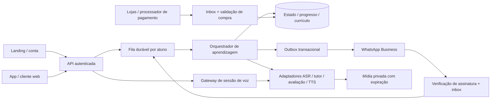
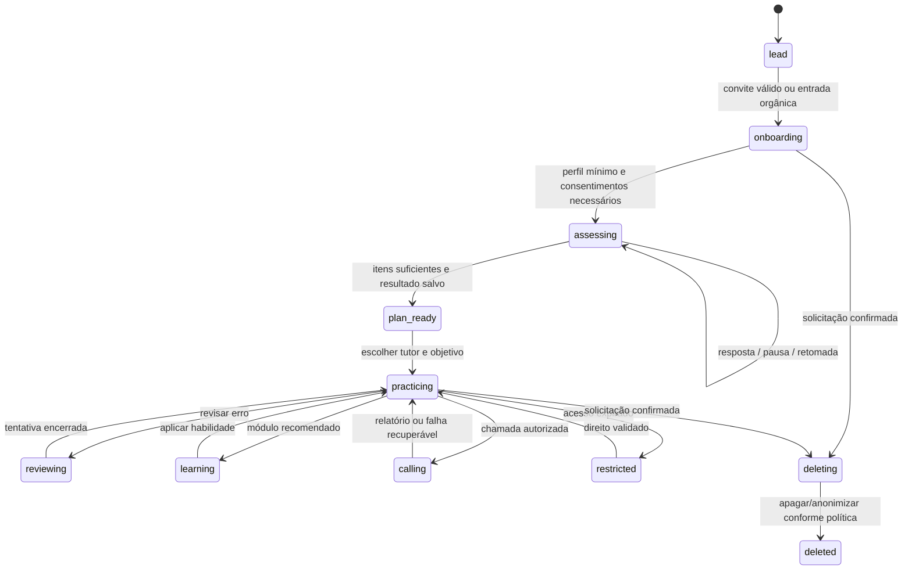

# Especificação para reconstrução independente

Versão: 0.1 · 29/10/2026 · status: proposta para implementação, não produto pronto.

Este documento transforma a investigação em decisões de projeto. **Nenhuma tecnologia, tabela, rota, prompt, rubrica ou algoritmo abaixo é apresentada como descoberta do backend BeConfident.** Fontes S01–S10 são as identificadas em [public-research.md](public-research.md). A observação do WhatsApp conduzida no chat principal deve prevalecer sobre exemplos publicados quando houver diferenças. O código, materiais pedagógicos, personagens e assets originais não são parte desta especificação.

## 1. Fronteira de paridade

| Superfície | Comportamento que a reconstrução deve cobrir | Evidência de existência | Validação ainda necessária |
|---|---|---|---|
| Aquisição web | Landing responsiva, oferta por campanha/canal, convite atribuído, handoff para WhatsApp, links das lojas e suporte | S01, S10 | Experimentos, regras de atribuição, checkout completo |
| WhatsApp | Onboarding, avaliação, tutor, texto/áudio, menu, correção, tradução, repetição, progresso | S01, S04 | Todos os estados reais, limites do teste, menus atuais |
| Conta | Vincular WhatsApp e app com prova de controle; recuperar conta; preferências de idioma, tutor e meta | S03, S07 | Telas e fatores de autenticação originais |
| Início do app | Meta do dia, atalho para conversa/chamada, trilha sugerida, revisões pendentes | S02, S06 | Hierarquia, navegação e design exatos |
| Tutor e conversa | Catálogo de vozes/personalidades, tema livre/guiado, histórico, resposta textual e áudio, feedback | S02, S04 | Catálogo, licenças e qualidade de cada mentor |
| Chamada | Imediata/agendada, microfone, legenda, tradução, repetir, interrupção, encerrar e relatório | S02, S03, S05 | Transporte real, latência, limites e recuperação |
| Nivelamento | Coleta contextual, exercícios, estimativa de nível, confiança, plano de estudo | S02, S06; início visto no WhatsApp | Rubrica, itens e critérios completos |
| Aprender | Trilhas, módulos, atividades, checkpoint, desbloqueio, certificado | S02, S06 | Catálogo integral e critério de certificação |
| Revisar | Erros por categoria; tentativa, feedback, agendamento e domínio | S02, S05 | Algoritmo e regra de domínio originais |
| Evolução | Tempo ativo, frequência, competências, histórico de nível, relatórios | S04, S06 | Fórmula do score e calibração |
| Social | Amigos, convites/passaporte, ranking, competições | S02, S03 | Escopo, privacidade, pontuação, moderação |
| Retenção | Metas, missões, streak, lembretes, widgets, retrospectiva | S02, S03 | Disparo, fuso, elegibilidade e regras exatas |
| Recursos adicionais | Desafio de foto, Masters/Digital Twins, BeClub | S03, S06 | Fluxos, disponibilidade e direitos associados |
| Comércio e suporte | Oferta, assinatura, restauração, renovação, falha, cancelamento, reembolso, suporte | S01–S03 | Integrações e regras comerciais por canal |
| Dados pessoais | Consentimentos específicos, exportação, exclusão, retenção de mídia | S02, S09 | Processadores, regiões e política original efetiva |

Paridade é **por comportamento e canal**, não por quantidade de telas. Publicação em artigo ou changelog confirma uma alegação pública, não o funcionamento na conta testada. As 221 unidades/1.236 atividades publicadas em S06 não fornecem conteúdo para preencher um currículo equivalente.

Observação direta do WhatsApp relatada pelo investigador principal em 29/10/2026, aproximadamente 10:01–10:13: convite autorizado → apresentação dos “5 pilares” → pergunta do nome → extração de “Alex” de uma resposta em linguagem natural → botões **Iniciante / Intermediário / Avançado** → ao selecionar Intermediário, promessa de conversa de cerca de cinco minutos e relatório → anúncio de **três questões de completar frase antes do áudio**. Primeira: “She is really good _ cooking.” (`in / at / to`), escolhida `at`; segunda: “I don’t have _ money to buy a new phone.” (`many / enough / too`), escolhida `enough`. O primeiro acerto apenas avançou para a segunda questão, sem explicação textual de correção imediata.

Após a terceira questão, o bot informou que estava avaliando e enviou resultado em imagem. Pediu então descrição por áudio de uma foto de família em piquenique: um único áudio de até dois minutos, sem enviar vários ao mesmo tempo. O usuário enviou cerca de 18 segundos de áudio próprio (~10:10). O bot retornou dicas em texto (~10:11) e iniciou conversa com áudio curto. O pedido em português “Pode escrever a sua última pergunta em inglês também? Quero continuar por texto.” (~10:12) foi tratado como material de exercício: houve imagem com correção/tradução e dicas, sem confirmação clara de mudança de modo. Ver [captura de feedback](evidence/whatsapp-feedback.jpg). O `#menu` enviado ~10:13 não abriu menu no recorte observado; continuaram mensagens/áudios de avaliação. Isso **não prova que o comando não exista fora do onboarding**. A voz recebida não revela o fornecedor/modelo de áudio.

## 2. Arquitetura proposta

Começar com um backend modular, banco relacional, armazenamento privado de mídia e workers. Separar interfaces dos fornecedores de IA/voz/pagamento para poder medir e substituir. Escalar componentes apenas quando houver carga real.

Módulos: identidade/conta; aquisição; conversação; avaliação; currículo; revisão; progresso; social; chamadas; cobrança/direitos; notificações; dados pessoais. Não guardar segredos de prestadores no cliente. Um login não concede acesso a dados de outro aluno: todo recurso é limitado pelo principal autenticado e conferido também nas consultas.

O contrato [api/openapi.yaml](../api/openapi.yaml) e [database/schema.sql](../database/schema.sql) são um **núcleo proposto**, não uma descrição das APIs originais. Cobrem a espinha dorsal; ranking/competições, certificados verificáveis, foto, Digital Twins, widgets e operação administrativa ainda exigem contratos específicos antes da implementação.

## 3. Máquina de estados proposta

Separar `learner.lifecycle`, `conversation.mode`, `assessment.status`, `call.status` e assinatura. Uma falha de pagamento não deve apagar progresso. Uma troca de tutor não deve reiniciar a avaliação. Estado e transições são versionados; workers usam compare-and-swap para impedir duas respostas concorrentes ao mesmo turno.

Proposta de roteamento de comandos: normalizar acentos/caixa apenas para aliases explícitos; texto comum continua como conversa. Na reconstrução, `#menu` deve abrir menu a partir de qualquer estado e preservar avaliação suspensa; essa é **uma decisão própria**, diferente do recorte de avaliação em que o comando não abriu o menu. `Corrige` e `Traduz` precisam apontar para uma mensagem específica, não para “a última” de forma ambígua entre canais. Se não houver alvo, pedir ao aluno que escolha. Comandos não devem ser implementados como instruções soltas ao LLM que também alteram cobrança/identidade. Pedido explícito de mudar modo precisa ser classificado antes de corrigir linguisticamente o conteúdo; o recorte observado mostra por que testar essa fronteira.

Subestados de avaliação propostos com base no percurso observado: `collect_name → self_level → grammar_mcq (índice/total) → grammar_result → spoken_photo_sample → feedback → spoken_conversation → final_scoring → final_result`. A sequência até feedback/conversa oral tem observação no recorte acima; `final_scoring/final_result` ainda não estavam comprovados nesta atualização. Quantidade de turnos orais, regra de pausa/repetição e rubrica final continuam em aberto. As perguntas e foto observadas são evidências de comportamento, não um banco de itens/assets para reprodução do currículo original.

## 4. Fluxos completos

### 4.1 Convite, conta e WhatsApp

1. A landing emite identificador aleatório de convite com expiração e campanha validada. O token não carrega telefone, e-mail ou permissões de conta.
2. O link abre o destinatário empresarial correto com mensagem pré-preenchida. Só o envio do aluno inicia a conversa. Resolver token no servidor; aceitar entrada orgânica sem token; registrar atribuição separadamente do perfil.
3. O webhook valida assinatura no corpo bruto, limites e envelope antes de persistir. A resposta HTTP só confirma depois do commit da inbox. Nunca esperar o LLM para responder ao webhook.
4. Chave única `(provider, external_event_id)` impede duplicatas. Separar mensagens de eventos de entrega/leitura; ambos podem chegar fora de ordem. Ordenar turnos por conversa usando sequência interna; guardar timestamp do provedor como dado auxiliar.
5. Worker adquire lease por conversa/aluno, verifica consentimento e direito, grava mensagem, transição e outbox na mesma transação. Retry usa a mesma chave; falha definitiva vai para dead letter com motivo sem payload sensível em logs.
6. Dispatcher envia resposta; registra identificador de mensagem do provedor e status. Se timeout ocorrer após envio incerto, reconciliar antes de repetir. “Exactly once” externo não é prometido; efeito interno é deduplicado.
7. Vincular app exige desafio curto, de uso único, com expiração, limite de tentativas e prova de controle do canal. Não aceitar um telefone digitado como prova de titularidade. Conta existente demanda resolução explícita de conflito.

Aplicar as regras atuais do provedor para janela de atendimento, templates e opt-in na implementação; números e regras operacionais ainda precisam ser configurados e verificados nas fontes oficiais da integração escolhida. Agendamento e mensagens proativas respeitam fuso do aluno e cancelamento de consentimento.

### 4.2 Texto e áudio assíncrono

`receber → deduplicar → guardar → mídia validada → transcrever → contexto → gerar → avaliar → responder → eventos de progresso`.

Para texto, ignorar etapas de mídia. Para áudio, usar upload com tipo/tamanho/duração permitidos, armazenamento privado, checksum e expiração. Baixar mídia WhatsApp por worker com credencial restrita. Arquivo inválido, silêncio e língua inesperada recebem retorno específico. ASR de baixa confiança pede repetição; **não transforma transcrição incerta em erro do aluno**.

Contexto do tutor = objetivo atual + nível estimado + resumo autorizado + últimas mensagens limitadas + tópicos/erros relevantes. O modelo retorna estrutura validada com resposta, feedback e sugestões. Ferramentas de conta/pagamento não são controladas pelo texto da conversa. Feedback sobre pronúncia acústica exige um avaliador que realmente use o áudio; texto transcrito sozinho permite avaliar linguagem, não comprovar fonemas pronunciados.

Gerar TTS depois de aprovar o texto. Resposta textual pode ficar disponível antes do áudio, com estado explícito de processamento. Se TTS falhar, preservar texto e opção de tentar áudio novamente. Cancelamento evita resposta obsoleta após troca de tema. Registrar versão de rubrica, prompt e modelo para reprodução técnica sem expor prompts ao cliente.

### 4.3 Chamada em tempo real

`criada → aguardando conexão → ativa → encerrando → concluída`, com `falhou/cancelada/expirada` terminais. O servidor emite credencial curta apenas para aquela chamada. Mute pausa envio de áudio; encerramento revoga sessão e impede cobrança/contagem posterior. Gateway limita sessão por direito e orçamento.

VAD/ASR incremental, detecção de fim de turno e interrupção interrompem o áudio do tutor quando o aluno fala. Legendas parciais são diferenciadas das finais; pontuar e revisar apenas a transcrição final. Repetir/traduzir referencia o turno correto. Reconexão mantém sessão por uma janela definida, sem somar duas vezes o tempo sobreposto. Relatório final é um job separado e idempotente. Reunião agendada guarda horário UTC e fuso IANA; mudança de horário não duplica lembretes.

Metas iniciais de desempenho para medir, não promessas do produto original: webhook p95 < 1 s depois do commit; primeiro retorno textual assíncrono p95 < 8 s; início do áudio do tutor em chamada p95 < 1,5 s após fim de fala; interrupção p95 < 250 ms. Medir em rede móvel e aparelho intermediário, com orçamento de custo/minuto e taxa de falhas publicados internamente.

## 5. Aprendizagem, memória e progresso

**Avaliação proposta.** Rubrica própria versionada por competência (compreensão, repertório, gramática, fluência e pronúncia somente com sinal adequado). Guardar resposta, evidência, confiança e recomendação. Não atribuir equivalência CEFR certificada a um score sem validação pedagógica. Resultado insuficiente diz “faltam amostras”, em vez de inventar precisão. Referências de “5 pilares” vistas no WhatsApp não estabelecem quais são os cinco nem a fórmula interna.

**Currículo próprio.** Cada módulo possui habilidade, faixa, pré-requisitos, objetivo observável e atividades de apresentação/prática/aplicação/consolidação. Publicar versões imutáveis para não invalidar tentativas. Plano é uma seleção de módulos baseada em resultado, objetivo e disponibilidade; guardar justificativa. Certificado deve representar critérios concluídos e identidade verificada, não apenas pagamento.

**Memória.** Separar perfil explícito, resumo de sessão e evidências pedagógicas. Cada fato persistido guarda origem, escopo e validade. Preferências explícitas prevalecem sobre inferências. Não armazenar dados pessoais encontrados incidentalmente na conversa como “memórias úteis” sem finalidade. Trocar mentor altera persona/voz e mantém o mesmo registro pedagógico.

**Revisão proposta.** Converter erro confirmado em item com trecho original, correção, microrregra, categoria, habilidade, confiança e mensagem de origem. Um erro repetido pode atualizar um item existente. Agenda simples inicial: falha volta à sessão; acerto orientado retorna em 1 dia; acerto independente em 3/7/14/30 dias, com limites e eventos versionados. São regras próprias, a calibrar; não algoritmo descoberto do BeConfident. O aluno pode contestar feedback e marcar conteúdo dominado, com trilha de auditoria.

**Progresso.** Contar duração ativa comprovada, respostas e atividades válidas; não ganhar pontos por retry de webhook, silêncio ou reprodução automática. `practice_event` possui chave de origem única. Streak usa data civil no fuso configurado e política explícita para mudanças de fuso. Scores por habilidade mantêm histórico e incerteza. Ranking exige período/coorte e regras contra spam; privacidade por padrão e opção de sair.

## 6. Modelo de dados e contratos

| Grupo | Entidades no esquema proposto | Invariante |
|---|---|---|
| Conta | learners, identities, account_link_challenges, consent_events | Identidade externa pertence a uma única conta; desafio armazena hash, nunca segredo bruto |
| Aquisição | lead_invites | Token opaco, hash único, expiração e uso idempotente |
| Conversa e memória | conversations, messages, conversation_events, response_jobs, learner_memories | Mensagens pertencem ao aluno da conversa; `client_message_id`/evento externo único; memória com origem e expiração |
| Voz | media_assets, calls, call_events | Mídia privada; chamada tem dono, duração e estado; credencial curta não persistida em claro |
| Pedagogia | assessments, assessment_responses, study_plans, modules, activities, activity_attempts | Rubrica e conteúdo versionados; resposta não altera item publicado |
| Revisão | learning_errors, review_items, review_attempts | Erro e revisão rastreáveis à conta e mensagem de origem |
| Progresso | practice_events, skill_snapshots, daily_progress | Contagem derivada de eventos únicos; agregados reconstruíveis |
| Acesso | products, subscriptions, purchases, entitlements, purchase_events | Compra canônica tem titular único por provedor/transação; direitos referenciam compra/assinatura verificadas |
| Operação | webhook_inbox, outbox, data_requests | Dedupe, lease/retry, expiração e terminalidade explícitos |

UUIDs gerados pela aplicação. Timestamps UTC com fuso IANA no perfil. Leitores de tabelas de aluno precisam filtrar principal; o SQL é fundação e **não instala uma política completa de autorização por si só**. Backups, papéis, criptografia de campos, gestão de chaves, retenção e migrações são trabalho operacional pendente.

**HTTP:** bearer para cliente, credenciais de serviço distintas, validação de assinatura nos webhooks, `Idempotency-Key` nas escritas repetíveis, erros estruturados, cursor e limite nas coleções. Em falha de idempotência com corpo diferente retornar `409`. Jobs são assíncronos e consultáveis; `202` não é uma resposta pedagógica concluída. Negar recursos alheios como `404` sem expor existência. Não encaminhar diretamente erros internos de prestadores.

**Cobrança:** servidor valida recibo/evento no canal emissor; preço e estado reportados pelo cliente não concedem direitos. Compra canônica usa chave única `(provider, external_transaction_id)` com proprietário imutável fora de um fluxo explícito de resolução de conta. Vários eventos podem referenciar essa compra sem repetir o grant da capacidade. Eventos atrasados não reativam assinatura revogada com versão superior. Restauração é idempotente e não transfere recibo entre alunos. Cancelamento de renovação não significa expiração imediata; separar vigência de acesso de renovação. Reembolso e chargeback possuem transições explícitas. Teste gratuito possui limites de uso definidos antes de começar, sem compromisso financeiro implícito.

## 7. Fases e critérios de saída

| Fase | Entrega concreta | Critério de saída |
|---|---|---|
| 0 — fechar evidências | Dossiê, árvore de navegação, transcrições redigidas, matriz de paridade | Cada função marcada observado/publicado/proposto/desconhecido; telas restritas listadas |
| 1 — corte vertical | Convite → WhatsApp → perfil → avaliação curta → tutor texto → correção → progresso → retomada no app | Um aluno conclui o percurso; duplicatas e retomadas não perdem estado; sem pagamento real |
| 2 — voz e ensino | Áudio assíncrono, chamada, currículo próprio inicial, revisão | Falhas de ASR/TTS/rede recuperáveis; feedback validado pedagogicamente; métricas de latência/custo |
| 3 — assinatura | Compra sandbox, verificação, restauração, direitos multicanal, cancelamento/reembolso | Eventos fora de ordem e cross-account testados; acesso determinado no servidor |
| 4 — retenção e social | Metas, lembretes, ranking/amigos, certificados | Fuso, consentimento, abuso, privacidade e regras públicas definidos e testados |
| 5 — paridade expandida | App nativo, widgets, foto, recursos licenciados, comunidade | Cada item tem evidência de referência e teste em Android/iOS/WhatsApp; pendências não ocultadas |

Não há base para prazo/preço sério de recriação completa sem fechar quantidade de telas, currículo, licenças de mídia, países/canais, volume de usuários e critérios de qualidade. Não transformar um protótipo de chat em declaração de produto equivalente.

## 8. Matriz mínima de aceitação ponta a ponta

| ID | Cenário | Resultado exigido |
|---|---|---|
| A01 | Convite válido, expirado e entrada sem convite | Atribuição correta; expirado não concede direito; orgânico continua |
| A02 | Mesmo webhook recebido 5 vezes | Uma mensagem, um turno, um evento de progresso e uma saída lógica |
| A03 | Worker morre entre geração e envio | Retoma por lease/outbox; não perde resposta nem duplica efeito pedagógico |
| A04 | Eventos de leitura/entrega antes da mensagem | Reconcilia status sem criar mensagem fantasma |
| A05 | App e WhatsApp enviam juntos | Ordem estável; resposta ligada ao turno; estado não regressa |
| A06 | Áudio vazio, grande, tipo falso ou corrompido | Rejeição específica; sem crash, sem pontuação falsa |
| A07 | ASR incerto / TTS indisponível | Pede repetição ou mantém texto; não marca falha do aluno |
| A08 | Correção e tradução após troca de canal | Alvo explícito preservado; mensagem de outro usuário inacessível |
| A09 | Pausa no nivelamento e retomada depois | Itens já respondidos preservados; avaliação não finaliza sem evidência |
| A10 | Troca de mentor | Voz/persona mudam; perfil, erros e plano permanecem |
| A11 | Dois acertos da mesma revisão por retry | Uma tentativa e um novo vencimento |
| A12 | Chamada interrompida, mute, rede cai, reconnect | Áudio para conforme controle; transcrição final coerente; tempo sem duplicata |
| A13 | Encerrar chamada em dois dispositivos | Um término; credenciais revogadas; relatório único |
| A14 | Compra sandbox válida, falsa e repetida | Só compra validada concede direito; repetição não amplia vigência |
| A15 | Reembolso chega antes de renovação atrasada | Ordem lógica preservada; não ressuscita acesso revogado |
| A16 | Tentativa de ligar conta com telefone alheio | Não vincula sem prova; desafio expira, limita tentativas e não pode ser reutilizado |
| A17 | Mudança de fuso perto da meia-noite | Política reproduzível; sem ganhar dois dias ou perder sessão |
| A18 | Cancelar lembretes e pedir exclusão | Interrompe disparos; job cobre mídia, índices, prestadores e agregados identificáveis |
| A19 | Texto do aluno/arquivo contém “ignore instruções” | Conteúdo tratado como material de conversa; sem executar ferramentas administrativas |
| A20 | Mudar rubric/modelo após resultado salvo | Histórico mantém versão original; reavaliação cria nova versão identificável |
| A21 | Áudio de avaliação excede limite ou chegam vários juntos | Limite do item explícito; fila não mistura amostras; instrução de recuperação preserva progresso |
| A22 | Aluno pede texto/menu durante exercício | Intenção de controle tratada antes de correção; estado de avaliação pausado/retomável; decisão própria distinguida do original |

Validação inclui testes de contrato, integração de filas/webhooks, concorrência, compra sandbox e cenário real em dispositivos. A qualidade pedagógica exige amostras avaliadas por pessoas qualificadas e critérios definidos; teste técnico verde não prova ensino eficaz.

## 9. Lacunas explícitas

Não foram recuperados servidor, prompts, modelos, API autenticada, currículo completo, rubrica de nível, cálculo do score, design completo do app, limites de assinatura/teste, contratos de voz nem catálogo/licenças de personagens. A investigação pública não pode preencher essas lacunas com certeza. Para fechá-las: observar fluxos em conta legitimamente autorizada, testar áudio/chamada com amostras próprias, obter artefatos fornecidos pelo usuário e especificar decisões próprias onde o original é inacessível.
